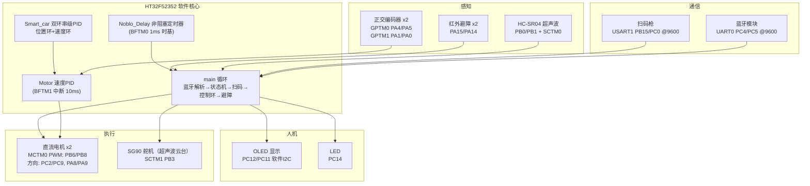

# HT32F52352 外设驱动与踩坑笔记 · 智能小车完整示例

**English** | Peripheral drivers, field-tested pitfalls and a complete smart-car example for the Holtek **HT32F52352** (Cortex-M0+, 48MHz): timer family usage, UART packet protocol, hardware quadrature decoding, cascade PID — plus an honest, fully-diagnosed I2C porting failure case.

---

HT32 系列的中文实战资料远少于 STM32。本仓库把一个完整跑通过的智能小车项目整理成四部分，供接触这款芯片的人直接取用：

- **`drivers/`** —— 16 个自包含的外设驱动模块（`.c/.h` 可直接拷走），覆盖 GPIO、软件 I2C OLED、双 UART 数据包、MCTM 电机 PWM、GPTM 硬件正交解码、SCTM 舵机与脉宽测量、非阻塞软定时器、串级 PID；
- **`docs/`** —— 按主题整理的**外设使用要点与踩坑**：定时器家族怎么分工、引脚冲突怎么排查、编码器测速为什么该用硬件解码而不是中断数脉冲、I2C 移植时 7-bit/8-bit 地址约定怎么坑人；
- **`project/`** —— 最终态**完整可编译**的 Keil 工程（从点灯到双环 PID 的整车），可作为新工程的起点模板；
- **`host/`** —— **配套上位机**（Python/Tkinter）：比赛题目"书库找书"的 PC 端——查书换编码、A\* 路径规划、生成 `@...` 指令发给小车，是 [docs/06 串口协议](docs/06-串口数据包协议.md)的发送端。

## 文档导航

| 文档 | 内容 | 适合谁 |
| --- | --- | --- |
| [01 项目概览](docs/01-项目概览.md) | 这台小车实现的功能与系统架构 | 所有人，3 分钟 |
| [02 快速上手与环境](docs/02-快速上手与环境.md) | 编译方法、工程结构、**从 STM32 例程迁移到 HT32 的差异点** | 想动手编译/移植的人 |
| [03 定时器家族与资源分配](docs/03-定时器家族与资源分配.md) | BFTM/GPTM/MCTM/SCTM 四类定时器的分工与选型经验 | **所有 HT32 用户** |
| [04 外设驱动要点与踩坑](docs/04-外设驱动要点与踩坑.md) | 每个模块的实现要点、引脚、坑 | 想抄驱动的人 |
| [05 非阻塞软定时器设计](docs/05-非阻塞软定时器设计.md) | 裸机"伪并发"：软定时器实例、共享实例陷阱、状态机模式 | 写裸机的所有人 |
| [06 串口数据包协议](docs/06-串口数据包协议.md) | `@...` 包头包尾状态机 + 环形缓冲发送，双串口复用 | 所有人 |
| [07 编码器测速与双环 PID](docs/07-编码器测速与双环PID.md) | 硬件正交解码、速度换算、串级 PID 结构与**真实调参记录** | 做控制的人 |
| [08 I2C 地址约定与 MPU-6050 移植案例](docs/08-I2C地址约定与MPU6050移植案例.md) | 一次失败移植的完整诊断：`0x1C` ≠ `0x68`，附总线扫描排查法 | 移植过 I2C 器件的人 |
| [09 引脚分配与冲突检查](docs/09-引脚分配与冲突检查.md) | 全板引脚预算表 + 冲突史 | 画引脚表之前 |

## 系统架构

## 几个可能直接帮到你的点

- **定时器选型**：本项目把 7 个定时器全部用上——`BFTM` 做系统时基、`GPTM` 做编码器正交解码、`MCTM` 做电机 PWM、`SCTM` 做舵机和超声波脉宽计数，选型依据见 [docs/03](docs/03-定时器家族与资源分配.md)；
- **编码器测速**：外部中断数脉冲在高转速下会丢计数（本项目实测踩坑），换 GPTM `TM_SMSEL_DECODER3` 硬件四倍频解码后零开销，见 [docs/07](docs/07-编码器测速与双环PID.md)；
- **裸机多任务**：一套 12 字节的软定时器实例 + 状态机，在 8KB RAM 的 M0+ 上实现蓝牙解析/运动序列/避障/OLED 刷新并行不阻塞，附两个经典误用场景的逐步推演，见 [docs/05](docs/05-非阻塞软定时器设计.md)；
- **I2C 移植失败案例**：MPU-6050 移植两次未通，事后定位为 7-bit/8-bit 地址约定混乱（驱动内部左移，却填了 `0x1C` 而非 `0x68`），文档给出总线扫描等通用排查法，见 [docs/08](docs/08-I2C地址约定与MPU6050移植案例.md)。

## 快速开始

**编译**（Keil MDK-ARM v5）：
1. 安装 Holtek HT32F5xxxx 器件支持包；
2. 打开 `project/HT32F52352_SmartCar_PID/Project/Templete.uvprojx`；
3. Rebuild 即可（编译产物目录已清空，会自动重新生成）。

**复用驱动**：把 `drivers/<模块>/` 的 `.c/.h` 拷进你的工程，依赖只有 Holtek 标准外设库；引脚在各文件顶部宏定义处修改。详见 [drivers/README.md](drivers/README.md)。

## 配套上位机

`host/` 是这套小车的 PC 端（Python/Tkinter，Windows 实测）：书名查位置编码 → A\* 在书库地图上规划 → 生成 `@F3_1_M2.` 式路径指令 → 串口发给小车。想看 docs/06 协议在真实业务里怎么被使用，或需要一个"bleak 后台事件循环线程 + Tkinter 主线程"的完整参考写法，直接翻它。运行方法与模块说明见 [host/README.md](host/README.md)。

## 项目背景

源自 2025 年春季的一个学期项目：从点灯开始，一个模块一个模块搭起这台小车（蓝牙指令、扫码定位、超声波+红外避障、编码器闭环行驶）。所有代码均在实际硬件上验证；唯一的例外是姿态传感器 MPU-6050——两次移植均未调通，项目因此归档。失败代码与完整诊断一并保留在 [drivers/MPU6050_failed](drivers/MPU6050_failed/) 与 [docs/08](docs/08-I2C地址约定与MPU6050移植案例.md)，希望它对后来者的价值不亚于那些调通的代码。

## 硬件清单

HT32F52352 开发板 · 双直流减速电机（霍尔编码器 13PPR × 减速比 45）· 双 H 桥驱动 · 0.96" OLED（SSD1306）· HC-SR04 · SG90 舵机 · 红外避障 ×2 · HC-06 蓝牙 · USB 扫码枪（串口输出）· MPU-6050（未调通）

## License

原创代码（`drivers/`、`docs/`、`host/`、`project/` 中的 `Hardware/User`）以 [MIT](LICENSE) 发布。`project/` 内随仓库分发的 Holtek 固件库与 ARM CMSIS 为官方原样文件，版权归原厂所有、遵循其原始许可，不适用 MIT——详见 [THIRDPARTY_NOTICES](project/HT32F52352_SmartCar_PID/THIRDPARTY_NOTICES.md)。
