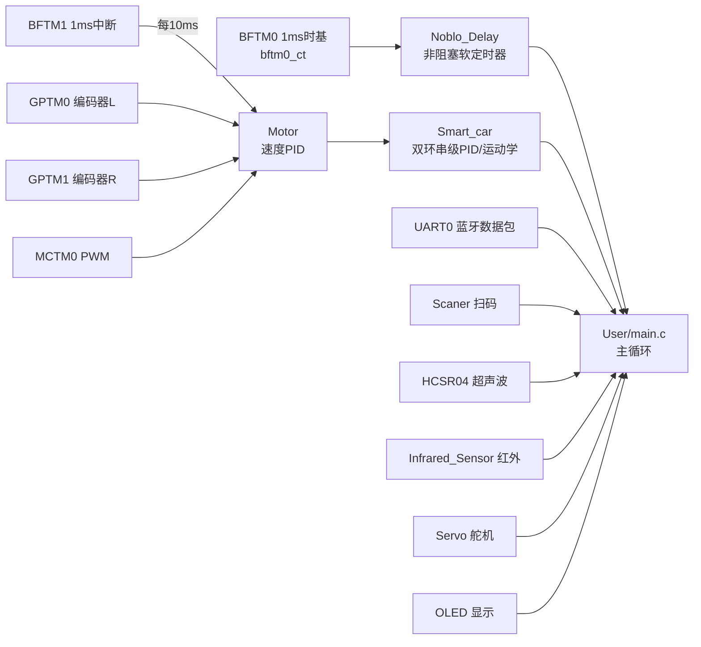

# 01 · 项目概览

一个基于 **HT32F52352** 的两轮智能小车完整示例：全部功能在实际硬件上验证通过，工程完整可编译。

## 功能一览

| 能力 | 实现方式 |
| --- | --- |
| 蓝牙遥控 | UART0 文本指令协议：`@Forward.` / `@SetSpeed:50.` 等，中断状态机拼包 |
| 路径任务 | `@F3_1_M2.` = 前进 3 格 → 左转 → 再走 2 格，非阻塞状态机执行，支持原路返回 |
| 行驶闭环 | GPTM 硬件正交解码测速，位置环 + 速度环串级 PID（10ms 周期），可指定厘米行驶 |
| 避障 | 超声波（舵机云台左右扫描比距选方向）+ 红外双保险 |
| 定位急停 | 扫码枪读取格子编号，与蓝牙下发的路径比对，一致即触发 EMG STOP |
| 人机界面 | OLED 实时回显指令、速度、传感器数据 |

## 外设资源占用

一颗芯片同时驱动以上全部功能，外设分配如下（细节见 [03 定时器家族](03-定时器家族与资源分配.md) 与 [09 引脚分配](09-引脚分配与冲突检查.md)）：

- **定时器 ×7**：BFTM0（1ms 系统时基）、BFTM1（10ms 控制周期）、MCTM0（双电机 PWM）、GPTM0/1（双编码器正交解码）、SCTM0（超声波回波计数）、SCTM1（舵机 50Hz）
- **串口 ×2**：UART0（蓝牙）、USART1（扫码枪）
- **GPIO**：OLED 软件 I2C ×2、电机方向脚 ×4、红外 ×2、超声波 ×2、LED ×1

## 软件结构

分层约定：`Hardware/` 全部是自包含驱动模块，模块间只通过头文件函数交互；`User/main.c` 是唯一的业务胶水层（蓝牙解析、运动状态机、避障策略）。这个结构使得任何模块都可以单独抽走复用——`drivers/` 目录就是按这个标准整理的。

## 已知局限

如实列出，避免误导后来者：

- 位置环完成判定只看编码器累计脉冲，无过冲回退，快速给定会冲过目标一小段；
- 两轮独立 PID，无航向融合，长距离直线会缓慢跑偏（原计划用 MPU-6050 解决，未完成）；
- 转向是开环定时（650ms ≈ 90°），非陀螺仪闭环；
- 超声波测距为阻塞式采样（单次约 60ms×5），运动中调用会短暂降低主循环响应。
