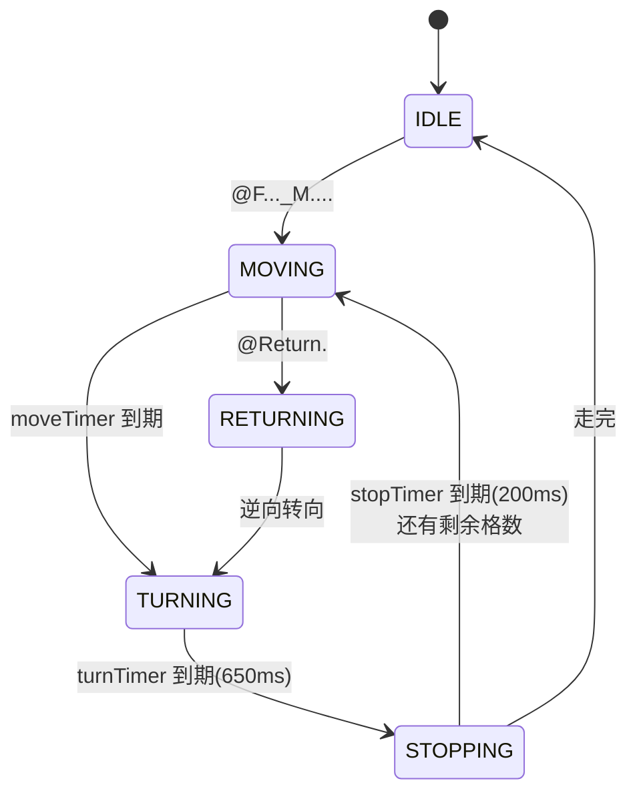

# 05 · 非阻塞软定时器设计

一套在 8KB RAM 的 Cortex-M0+ 上经过整车验证的裸机"伪并发"方案：**一个硬件时基 + N 个 12 字节的软定时器实例 + 状态机**。本文同时给出两个经典误用场景的逐步推演——它们是这类设计最常见的坑。

## 设计

**时基**：BFTM0 每 1ms 中断一次，维护全局毫秒时间戳：

```c
volatile uint32_t bftm0_ct;

void BFTM0_IRQHandler(void) {
    BFTM_ClearFlag(HT_BFTM0);
    bftm0_ct++;
}
```

**软定时器**：每个实例记录启动时刻的快照，主循环轮询：

```c
typedef struct {
    uint32_t start_time;   // 启动时刻的 bftm0_ct 快照
    uint32_t delay_ms;     // 目标延时
    uint8_t  is_running;   // 运行标志
} DelayTimer;              // 12 字节

uint8_t Delay_NonBlocking(DelayTimer *timer, uint32_t delay_ms)
{
    if (!timer->is_running) {                  // 未启动 → 启动
        timer->start_time = bftm0_ct;
        timer->delay_ms    = delay_ms;
        timer->is_running  = 1;
        return 0;
    }
    if (bftm0_ct - timer->start_time >= timer->delay_ms) {  // 到期
        timer->is_running = 0;
        return 1;
    }
    return 0;
}
```

源码：`drivers/Noblo_Delay/`。

两个设计细节：

- **溢出回绕天然安全**：`bftm0_ct - start_time` 是无符号减法，32 位毫秒计数约 49.7 天回绕一次，差值计算依然正确，无需特殊处理；
- **启动与到期分离**：第一次调用只"上闹钟"不判断，返回 0；到期那次调用返回 1 并自动停止，是否重启由调用者决定（支持每周期时长不同的序列）。

## 误用一：多个任务共享同一个实例

两个任务用同一个 `timer` 各设不同时长（1000ms / 2000ms），执行时序如下：

| 循环轮次 | bftm0_ct | 任务 A（Delay 1000） | 任务 B（Delay 2000） |
| --- | --- | --- | --- |
| 1001 | 1000 | 到期返回 1，`is_running=0` | 还差 1000ms |
| 1002 | 1001 | **重新启动**（start_time 被覆盖） | **重新初始化** start_time=1001 |
| … | … | 1000ms 节奏被持续打断 | 2000ms 永远"重新开始"，无法到期 |

根因：第一个任务到期清掉 `is_running` 后，下一个循环里另一个任务立即重新初始化实例，**把前者刚要用的计时基准覆盖掉**。

**规则：每个独立的时间事件必须持有独立的 `DelayTimer` 实例。** 实例仅 12 字节，成本可以忽略。这与多线程里的"共享可变状态"竞争是同构问题。

## 误用二：两个实例各管一个电平阶段

需求"低 800ms 高 1500ms"，直觉写法是两个实例分别管低、高电平。两实例**各自都正确**，组合却是错的：触发顺序不可控，实测出现低电平持续 1500ms、高电平只剩 800ms 的颠倒。

**正确姿势：单实例 + 状态机，把下一阶段的时长作为参数动态传入**：

```c
if (Delay_NonBlocking(&ledTimer, ledState ? 1500 : 800)) {
    ledState = !ledState;
    GPIO_WriteOutBits(HT_GPIOC, GPIO_PIN_14, ledState);
}
```

到期后翻转状态，并以新状态对应时长立即启动下一段计时——计时起点在每次切换时重置，误差不累积，且只有一条状态迁移路径，不存在竞争。

## 应用：小车的运动序列状态机

`@F3_1_M2.`（前进 3 格 → 左转 → 再走 2 格）这类多阶段动作，用五态状态机 + 每态独立定时器实现，主循环里蓝牙解析、避障、OLED 刷新全程不被阻塞：



完整实现在 `project/HT32F52352_SmartCar_PID/User/main.c` 的 `MotionStateMachine()`。

## 适用边界

- 任务量小、周期离散：本方案 + 手写状态机最省资源，**不必上 RTOS**；
- 任务多、优先级关系复杂、有长阻塞调用：应升级为时间片调度或 RTOS；
- 中断里不要调 `Delay_NonBlocking`（它非重入），中断需要定时逻辑时用硬件定时器或独立的基于 `bftm0_ct` 快照的轻量判断。
