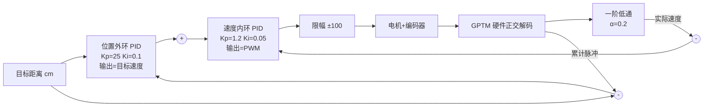

# 07 · 编码器测速与双环 PID

本项目控制部分的全貌：从"电机能转"到"说走 10cm 就走 10cm"。含一个实测踩坑（中断数脉冲测速失真）、一套串级 PID 的真实参数与调参顺序，源码在 `drivers/Motor/` 与 `drivers/Smart_car/`。

## 控制结构（最终形态）



## 测速：为什么必须用硬件正交解码

| 方案 | 实现 | 结果 |
| --- | --- | --- |
| 外部中断数脉冲 | A 相上升沿进中断计数 | ❌ **高转速下中断过载丢计数，速度读数失真**（本项目实测踩坑，该版本已废弃） |
| GPTM 正交解码 | A/B 相接 CH0/CH1，硬件计数辨向 | ✅ CPU 零开销，永不丢计 |

配置只要三行：

```c
TM_DecoderConfig(HT_GPTM0, TM_SMSEL_DECODER3,
                 TM_CHP_NONINVERTED, TM_CHP_NONINVERTED);
TM_Cmd(HT_GPTM0, ENABLE);
// 读数：TM_GetCounter(HT_GPTM0)
```

**经验：能交给定时器硬件的不要用中断。** 另外，硬件计数器位宽有限，里程不要依赖它直读——本项目每 10ms 读一次增量，累加进 `int32_t` 软件里程（`Motor.c` 的 `Read_xxxEncoder()`）。

## 速度环（内环）

调度：BFTM1 每 1ms 中断，数满 10 次执行一次 PID——**控制周期 10ms 由硬件定时器保证，不依赖主循环节奏**：

```c
void BFTM1_IRQHandler(void) {
    static uint16_t Count = 0;
    if (++Count >= 10) { Count = 0; Motor_UpdateSpeed(); }
    BFTM_ClearFlag(HT_BFTM1);
}
```

`Motor_UpdateSpeed()` 三步：

1. 读编码器增量 ÷ 0.01s → 实际速度；
2. 位置式 PID（积分限幅 ±1000）：`output = Kp*e + Ki*Σe + Kd*Δe`，参数 `Kp=0.20, Ki=0.00015, Kd=0`；
3. 输出限幅 ±100；符号 → 方向脚电平，绝对值 → PWM 占空比。

目标速度随时可改（`LeftMotor_SetSpeed(-100~100)`），中断自动维持转速。

## 距离换算

编码器脉冲与行驶距离的确定换算，是"指定厘米行驶"的基础：

```c
#define WHEEL_DIAMETER  6.5f   // 轮径 cm
#define PPR             13     // 编码器线数
#define GEAR_RATIO      45     // 减速比

// 四倍频后每转脉冲 = PPR × 4
target_pulses = (distance_cm / (3.14159f * WHEEL_DIAMETER)) * PPR * 4 * GEAR_RATIO;
```

`Move_Forward_Distance(10)` = 复位编码器 → 写入目标脉冲 → 位置环开跑。

## 位置环（外环）与串级

单环"距离误差 → PWM"的问题：误差大时输出长期饱和，接近目标时易冲过头。串级后外环输出的是**目标速度**而非 PWM，行为变成"先快后慢、平滑趋近"：

```c
/* 位置环：误差(死区±5脉冲) → 目标速度 */
float target = Position_PID(&s_left_pos_pid, pos_error, dt);   // Kp=25, Ki=0.1

/* 实际速度：一阶低通抑制编码器量化抖动 */
s_filtered = 0.2f*real + 0.8f*s_filtered;

/* 速度环：速度误差 → PWM */
float pwm = PID_Calculate(&s_left_speed_pid, target - s_filtered, dt);  // Kp=1.2, Ki=0.05
```

- 外环带死区（±5 脉冲）防止在目标附近振荡；
- 完成判定：左右累计脉冲均 ≥ 目标 → 停车。

## 调参顺序（无上位机的土办法）

OLED 实时显示目标值/实际值，每次只动一个参数：

1. `Ki=Kd=0`，从零加 `Kp` 到临界振荡，回退 30~40%；
2. 加小 `Ki` 消除稳态误差（本机量级：速度环 1e-4，位置环 1e-1——外环输出的是速度，量纲不同，系数自然大）；
3. 编码器量化抖动明显 → **先试低通滤波再考虑 `Kd`**。本项目低通就够用，`Kd` 始终为 0。

## 已知局限

- 完成判定只看脉冲数到达，无过冲回退；
- 双轮独立控制，无航向融合，长距离直线缓慢跑偏（原计划 MPU-6050 航向闭环，未完成，见 [08](08-I2C地址约定与MPU6050移植案例.md)）；
- 原地转向仍是开环定时（650ms ≈ 90°）。
