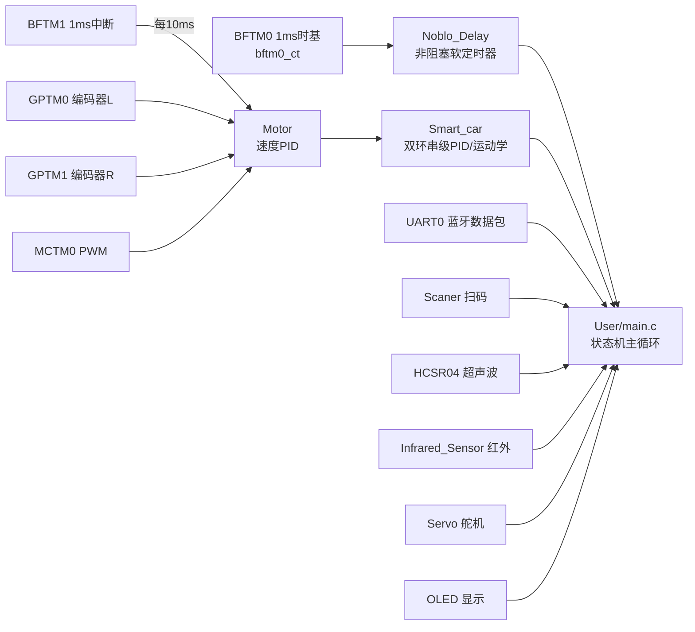

# 驱动模块画廊（Drivers Gallery）

这里是从最终工程 `HT32_15.3` 的 `Hardware/` 目录中提炼出的全部自写驱动，以及 `HT32_16` 两次失败的 MPU-6050 尝试（保留作反面教材）。

每个目录都是自包含的 `.c/.h` 对，依赖只有 Holtek 标准外设库（`ht32f5xxxx_01.h` 等，见 `project/HT32F52352_SmartCar_PID/Libraries/`）。芯片为 **HT32F52352**（Cortex-M0+, 48MHz），Keil MDK 工程。

> 引脚是在自己的小车上定义的，移植时请按你的硬件改各文件顶部的宏。

## 模块清单

| 目录 | 功能 | 占用的硬件资源 | 备注 |
| --- | --- | --- | --- |
| `LED/` | 板载 LED 闪烁 | PC14 | 最简入门 |
| `delay/` | 阻塞式延时（SysTick） | SysTick | 早期方案，主循环里别用 |
| `Noblo_Delay/` | **非阻塞软定时器** | BFTM0（1ms 时基） | 本项目最重要的软件设计，见 [docs/05](../docs/05-非阻塞软定时器设计.md) |
| `BFTM0/` | 1ms 系统时基中断 | BFTM0 | `bftm0_ct` 每毫秒自增 |
| `BFTM1/` | 1ms 控制周期中断 | BFTM1 | 中断里数 10 次调一次 PID（10ms 周期） |
| `OLED/` | 0.96" OLED（SSD1306） | PC12=SCL / PC11=SDA（软件 I2C） | 含 6x8/8x16 字库 |
| `UART0/` | 蓝牙串口 + **数据包状态机** | PC4=TX / PC5=RX @9600 | 环形缓冲发送 + `@...` 包头 `.` 包尾接收，见 [docs/06](../docs/06-串口数据包协议.md) |
| `Scaner/` | 扫码模块（第二路串口） | USART1: PB15=TX / PC0=RX @9600 | 与 UART0 同构的缓冲结构 |
| `MCTM0/` | 电机 PWM | PB6=CH2（右）/ PB8=CH3（左） | 含输出禁用/恢复（刹车时安全拉低） |
| `Motor/` | **电机+编码器+速度 PID** | 方向脚：左 PC2/PC9，右 PA8/PA9 | 见 [docs/07](../docs/07-编码器测速与双环PID.md) |
| `GPTM0/` | 左轮编码器（硬件正交解码） | PA4=A / PA5=B，Decoder Mode 3 | 硬件计数，不占 CPU |
| `GPTM1/` | 右轮编码器（硬件正交解码） | PA1=A / PA0=B | 原用 PC11 与 OLED 冲突后迁移 |
| `Servo/` | SG90 舵机 | PB3，SCTM1，50Hz | 0.5~2.5ms 脉宽映射 0~180° |
| `HCSR04/` | 超声波测距 | PB0=Trig / PB1=Echo，SCTM0 计数 | 5 次采样中值滤波，带超时保护 |
| `Infrared_Sensor/` | 红外避障（左右） | PA15=左 / PA14=右 | 0=有障碍 |
| `Smart_car/` | 小车运动学 + **双环串级 PID** | — | 位置外环+速度内环，见 [docs/07](../docs/07-编码器测速与双环PID.md) |
| `MPU6050_failed/` | **两次失败的 MPU-6050 移植** | — | 案例分析与修复方法见 [docs/08](../docs/08-I2C地址约定与MPU6050移植案例.md) |

## 依赖关系

## 快速上手（把某个驱动抄进你自己的工程）

1. 把对应目录的 `.c/.h` 拷到你的 `Hardware/`；
2. 在 Keil 工程里添加源文件和头文件路径；
3. 打开对应外设时钟 + AFIO 时钟（每个 `XXX_Init` 里已经写好了）；
4. 按 [docs/09](../docs/09-引脚分配与冲突检查.md) 的引脚预算表核对是否冲突（本项目舵机换定时器、编码器让引脚，都是因为冲突）。
