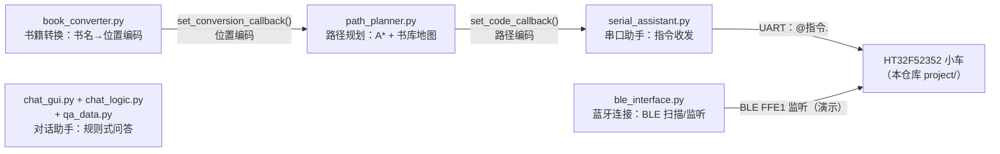

# host · 智能书库导航系统 PC 端（配套上位机）

这台小车的另一半：比赛题目是"书库找书机器人"，小车在书架间取书，而**人怎么告诉小车去哪**，就是这个 Python 桌面程序要解决的事——查书 → 换编码 → 规划路径 → 生成 `@...` 指令 → 串口/蓝牙发给小车。它是 [`docs/06-串口数据包协议`](../docs/06-串口数据包协议.md) 中那套协议的**发送端**，两个目录合起来才是完整的通信闭环。

> 这是 2025 年比赛期间的实际工作代码，按"存档"定位开源：能跑、有完整的模块间协作设计，但保留着当时的教学式写法与硬编码，没有为开源重构。三处明显笔误（按钮标签、重复函数定义、死代码副本）在入库时已修正，其余保持原样。

## 工作流

1. **书籍转换**：输入书名（带模糊补全），查出位置编码，如《数学分析》→ `@01020A01.`；
2. **路径规划**：编码经回调送入 A\* 模块，在书库地图上标出目标点，生成路径编码如 `@F3_1_M2.`；
3. **串口助手**：路径编码经回调填入发送区，一键发给小车；
4. 小车按指令行驶，扫码枪回传格子编号与路径比对（固件侧逻辑，见 [docs/06](../docs/06-串口数据包协议.md)）。



主入口 [`main.py`](main.py) 用 `ttk.Notebook` 把五个模块装进一个窗口，`setup_module_links()` 用回调把"书籍转换 → 路径规划 → 串口助手"串成一条链——这是本程序最值得看的设计。

## 模块说明

| 文件 | 职责 | 值得看的点 |
| --- | --- | --- |
| `main.py` | 主窗口、模块装配与回调接线 | Notebook 多页签 + 模块解耦回调 |
| `book_converter.py` | 书名 → 位置编码（30 本书的映射表） | 打分式模糊搜索补全 |
| `path_planner.py` | A\* 寻路 + matplotlib 地图嵌入 Tkinter | 堆优化 A\*（节点缓存）；matplotlib 控件叠加右键菜单 |
| `serial_assistant.py` | 串口收发（HEX/文本、GBK/UTF-8） | 读线程 + 队列转 `after()` 回主线程；快捷指令面板 |
| `ble_interface.py` | BLE 扫描/连接/监听（bleak） | **asyncio 事件循环跑在后台线程**，`run_coroutine_threadsafe` 桥接 Tkinter 主线程——这个模式很容易写错，此处是可参考的完整写法 |
| `chat_gui.py` / `chat_logic.py` / `qa_data.py` | 对话助手 | 约 380 条问答库 + 字符重叠模糊匹配（教学演示水平，如实标注） |

## 路径编码怎么生成

书库建模为 11×22 网格（`path_planner.py` 中的 `grid`，1 为书架/墙），30 个位置编码硬编码映射到网格坐标（`coord_map`）。A\* 求出路径后，**编码只取起点与终点的位移**：

```
@F{前进格数}_{转向}_M{再走格数}.
转向：1 左 / 2 右 / 0 同列直行
```

即"前进→转向→再走"三段式，与固件命令层的解释一一对应（见 [docs/06 命令层](../docs/06-串口数据包协议.md)）。A\* 在这里的实际作用是**验证目标可达**并给出位移量，而非逐格路径跟踪——小车靠编码器和扫码枪保证走直线与到位确认。

> 注意：`_0_`（同列直行）是上位机会生成的取值，docs/06 的指令表只列了 1/2，读固件命令层时请一并考虑。

## 运行

```bash
pip install -r requirements.txt   # Python >= 3.8
python main.py
```

Windows 下开发/验证（Tkinter + SimHei 字体 + GBK 编码选项均为 Windows 生态）；理论上跨平台，未验证。地图、书库映射、串口快捷指令均为比赛现场的硬编码，换场地需改 `path_planner.py` 的 `grid`/`coord_map` 与 `book_converter.py` 的映射表。

## 已知局限

- **蓝牙模块只完成了"扫描—连接—监听"**，发送链路没有接进工作流（实际比赛用 USB 串口），`send_command()` 是留了没用上的接口；
- 对话助手的"模糊匹配"是字符集合重叠的启发式，仅能处理粗略的近义问法；
- `update_history`/历史记录的注释与实际行为不符（新记录在底部而非顶部）之类的小毛病保留原样。

## Roadmap（如果有人想接着写）

- 地图与书库映射改为配置文件（JSON/YAML）加载；
- 蓝牙发送接入工作流，串口/蓝牙可切换；
- PyInstaller 打包单文件 exe。

## 依赖与许可证

原创代码，随本仓库以 [MIT](../LICENSE) 发布。第三方依赖均为宽松许可：bleak（MIT）、pyserial（BSD-3-Clause）、matplotlib（BSD-3-Clause）、pyperclip（BSD-3-Clause），未随仓库分发。
